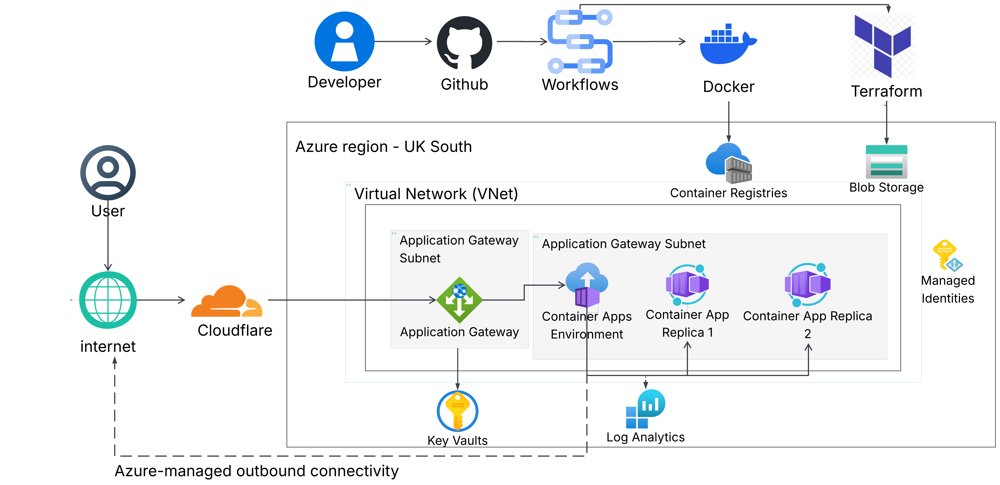
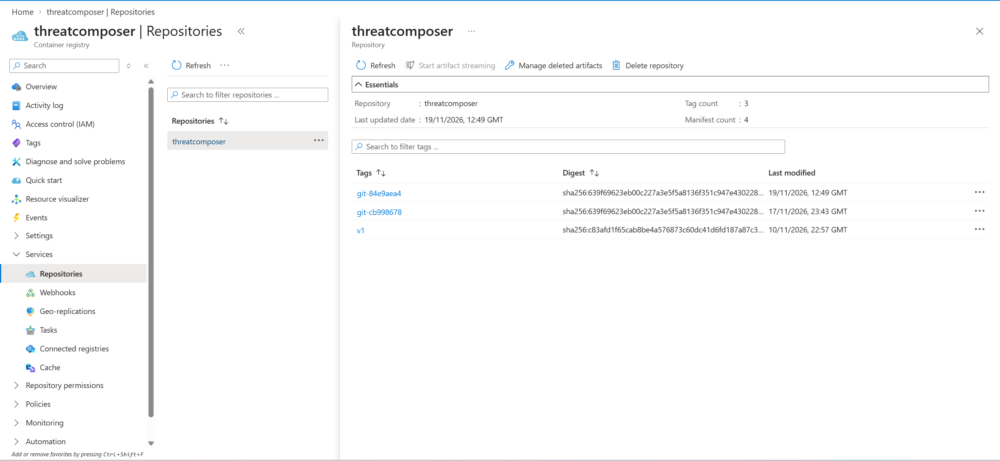
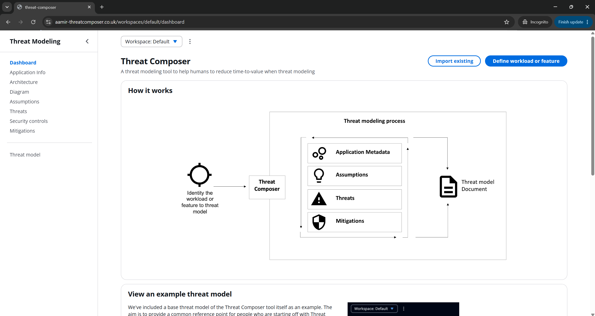
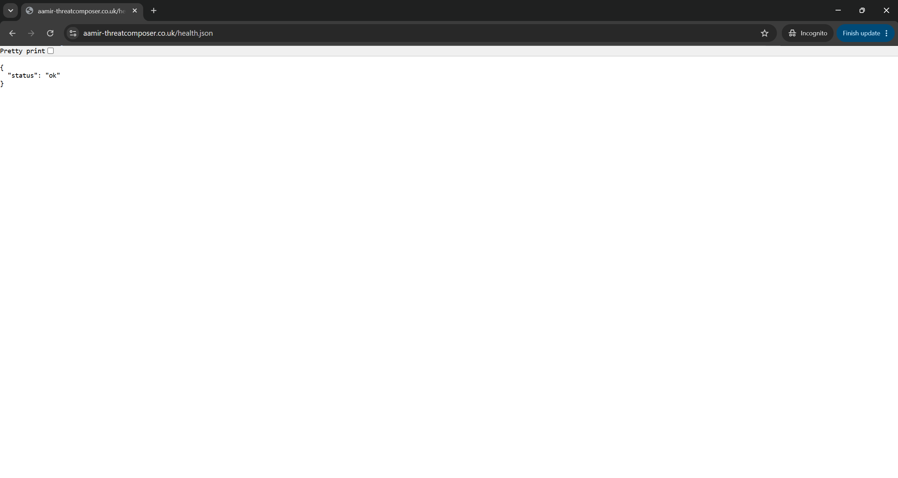
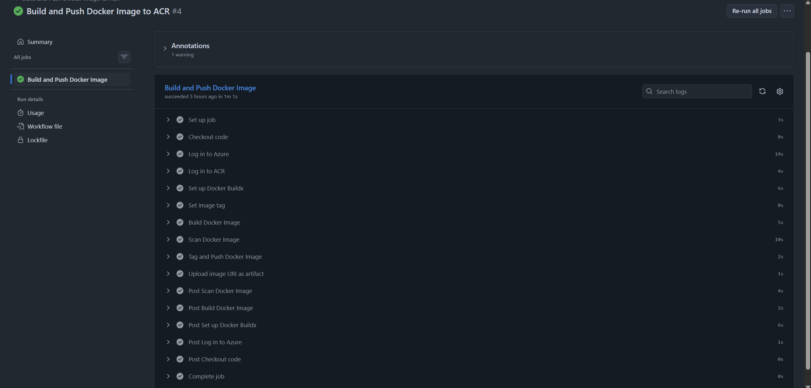
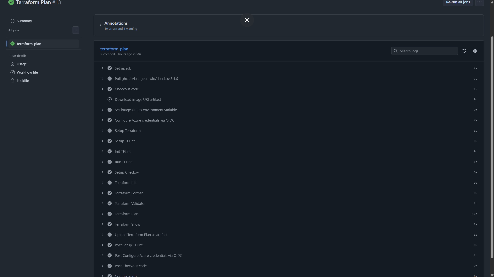
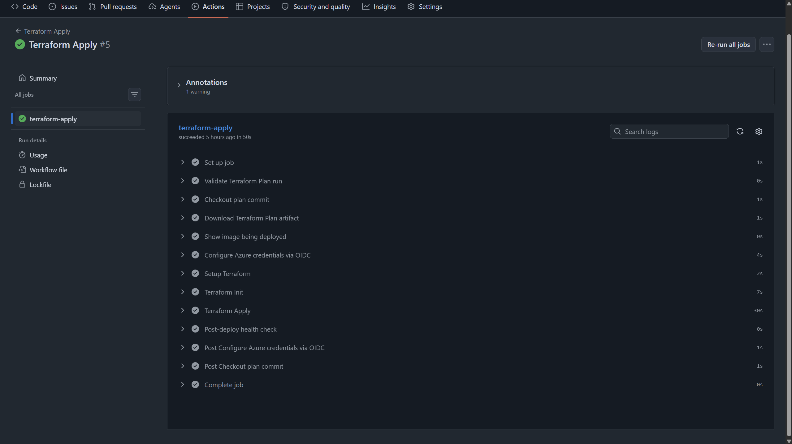
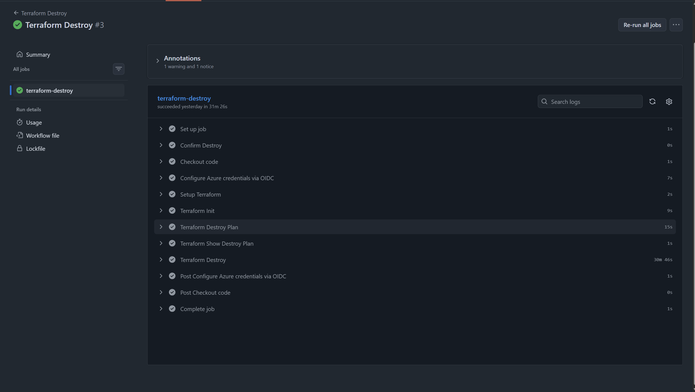

# End to End Production-Grade Deployment on Azure Container Apps (Threat Composer)
----
A production-grade containerised application deployment on Microsoft Azure, demonstrating Infrastructure as Code (IaC), Secure CI/CD automation and cloud security best practices.

### Project Overview

This project demonstrates the deployment of a React-based threat modelling application to Microsoft Azure using Terraform and GitHub Actions.

The infrastructure is provisioned using Terraform, with GitHub Actions automating container builds, security scanning, infrastructure planning and deployment.

Authentication between GitHub Actions and Azure uses OpenID Connect (OIDC) and User Assigned Managed Identities, eliminating the need for long-lived Azure credentials.

## Architecture



Incoming HTTPS traffic is routed through Application Gateway to the internal Container Apps Environment, while outbound connectivity is provided through Azure-managed egress.

---
## What is Threat Composer?

Threat Composer is a web-based threat modelling application that helps teams identify, visualise and manage security threats across modern systems.

It enables engineers and security practitioners to document threats, track mitigations and capture assumptions during the system design process.

I chose Threat Composer because its lightweight web architecture allowed me to focus on the infrastructure, security, networking, automation and CI/CD involved in deploying and operating an application reliably in the cloud.

---
## What I built:
- **Azure infrastructure:** Deployed a containerised application using Azure Container Apps, Application Gateway and a dedicated Virtual Network.
- **Infrastructure as Code:** Provisioned modular Azure infrastructure using Terraform, with separate bootstrap and main configurations.
- **Automated CI/CD:** Built GitHub Actions workflows for container builds, security scanning, infrastructure planning and deployment.
- **Identity and access management:** Implemented OIDC authentication and separate managed identities for CI/CD workflows.
- **Container security:** Integrated Trivy, Checkov and TFLint into the development and deployment workflows.
- **Remote state management:** Configured Azure Blob Storage as the Terraform remote backend.

## Tech Stack

### Cloud & Infrastructure

- **Microsoft Azure** – Cloud hosting platform.
- **Azure Container Apps** – Managed container hosting and autoscaling.
- **Azure Container Registry (ACR)** – Private Docker image storage.
- **Azure Application Gateway** – Application entry point and HTTPS traffic management.
- **Azure Key Vault** – Secrets and certificate management.
- **Azure Virtual Network** – Network isolation and connectivity.
- **Azure Storage Account** – Terraform remote state storage.
- **Azure Managed Identities** – Passwordless authentication between services.

### Infrastructure as Code (IaC)

- **Terraform** – Infrastructure provisioning and lifecycle management.
- **Terraform Modules** – Reusable infrastructure components.
- **Terraform Bootstrap** – Manages foundational resources required by the main configuration.

### CI/CD & DevSecOps

- **GitHub Actions** – Automated build, security and deployment workflows.
- **OIDC** – Federated authentication between GitHub Actions and Microsoft Entra ID.
- **Trivy** – Container image vulnerability scanning.
- **Checkov** – Terraform security and misconfiguration scanning.
- **TFLint** – Terraform configuration linting.

### Containers & Application

- **Docker** – Container image creation and packaging.
- **React** – Threat Composer application.
- **Nginx** – Production web server for the React application.

  ---
  ## Project Structure

```text
azure-threatcomposer/
├── .github/
│   └── workflows/
│       ├── apply.yaml
│       ├── destroy.yaml
│       ├── docker-push.yaml
│       └── plan.yaml
│
├── app/
│   └── Dockerfile
│
├── terraform/
│   ├── bootstrap/
│   │   ├── identities.tf
│   │   ├── main.tf
│   │   ├── outputs.tf
│   │   ├── provider.tf
│   │   ├── rbac.tf
│   │   ├── terraform.tfvars
│   │   └── variables.tf
│   │
│   ├── modules/
│   │   ├── application_gateway/
│   │   │   ├── main.tf
│   │   │   ├── outputs.tf
│   │   │   └── variables.tf
│   │   ├── container_app/
│   │   │   ├── main.tf
│   │   │   ├── outputs.tf
│   │   │   └── variables.tf
│   │   ├── dns/
│   │   │   ├── main.tf
│   │   │   ├── outputs.tf
│   │   │   └── variables.tf
│   │   ├── monitoring/
│   │   │   ├── main.tf
│   │   │   ├── metric-alerts.tf
│   │   │   ├── outputs.tf
│   │   │   └── variables.tf
│   │   └── vnet/
│   │       ├── main.tf
│   │       ├── outputs.tf
│   │       └── variables.tf
│   │
│   ├── cloudflare.tf
│   ├── main.tf
│   ├── provider.tf
│   ├── terraform.tfvars
│   └── variables.tf
│
├── .gitignore
├── .trivyignore
├── .pre-commit-config.yaml
└── README.md

```
## Running the Application Locally

### Prerequisites

- Node.js 24+
- Yarn package manager
- Docker

 ### Option 1: Without Docker

```bash
cd app
yarn install
yarn build
yarn global add serve
serve -s build
```
Application runs locally at:

```text
http://localhost:3000
```
### Option 2: With Docker

Build the Docker image:

```bash
docker build -t threatcomposer:local ./app
```
Run the container:

```bash
docker run -d \
  --name threatcomposer \
  -p 8080:80 \
  threatcomposer:local
```
Application runs locally at:

```text
http://localhost:8080
```

---
## Container Registry (ACR)

Azure Container Registry (ACR) provides private storage for application images.

The registry uses managed identity-based authentication, with administrative credentials disabled.

The Docker workflow builds and scans the image before pushing a versioned image tagged with the Git commit SHA.



---

## Production Deployment

The deployment uses:

- **Application Gateway:** Handles incoming application traffic and HTTPS.
- **Container Apps Environment:** Hosts the application and its replicas within the Virtual Network.
- **Key Vault:** Provides access to certificates and secrets.
- **Cloudflare:** Manages DNS records for the custom domain.

### Live Endpoint

```text
https://aamir-threatcomposer.co.uk
https://aamir-threatcomposer.co.uk/health.json
```
### Verified Production Deployment






---

## CI/CD Pipeline (GitHub Actions)

Four GitHub Actions workflows automate the application and infrastructure lifecycle.

Separate User Assigned Managed Identities provide distinct permissions for each workflow.


### Workflow Overview

**1. Docker Build & Push (`docker-push.yaml`)**



- Builds the React application into a Docker image.
- Scans the image using Trivy.
- Authenticates to Azure using OIDC.
- Pushes the image to ACR.
- Tags images using the Git commit SHA.

**2. Terraform Plan (`plan.yaml`)**



- Runs TFLint and Checkov.
- Executes `terraform fmt` and `terraform validate`.
- Generates a Terraform execution plan.
- Uploads the saved plan as a GitHub Actions artifact.

**3. Terraform Apply (`apply.yaml`)**



- Authenticates using the dedicated Apply managed identity.
- Downloads the saved Terraform plan.
- Applies the reviewed infrastructure changes.
- Runs a post-deployment application health check.

**4. Terraform Destroy (`destroy.yaml`)**



- Manually triggered through GitHub Actions.
- Requires explicit confirmation before proceeding.
- Generates and displays a destruction plan.
- Applies the saved plan to remove the main infrastructure.
---

## Cost Breakdown & Optimisation

| Azure Service | SKU | Hourly | Daily | Monthly (30 days) |
|---|---|---:|---:|---:|
| Application Gateway | Standard_v2 | £0.1887 | £4.53 | £135.86 |
| Public IP | Standard | £0.0038 | £0.09 | £2.74 |
| Container Registry | Basic | £0.0052 | £0.12 | £3.73 |
| **Total fixed costs** | | **£0.1977** | **£4.74** | **£142.33** |

Additional usage-based charges apply:

- **Container Apps:** Consumption billing based on vCPU-seconds, GiB-seconds and requests. Configured with 0.5 vCPU, 1 GiB memory and 2–5 replicas.
- **Key Vault:** Charged per operation.
- **Log Analytics:** Charged based on data ingestion and retention.
- **Storage Account:** Charged based on storage capacity and transactions.
- **Application Gateway:** Additional capacity-unit charges based on traffic and usage.

### Cost Optimisation

- **Consumption-based compute:** Azure Container Apps charges based on resource consumption rather than dedicated infrastructure.
- **Replica scaling:** Configured between 2 and 5 replicas to balance availability and compute costs.
- **Multi-stage Docker builds:** Keeps build dependencies out of the production image, reducing image size.
- **ACR Basic:** Uses a lower-cost registry tier suitable for this application.
- **Terraform destroy:** Allows infrastructure to be removed when it is no longer required.
- **Monitoring:** Reviewing Log Analytics ingestion and Application Gateway capacity helps identify unnecessary expenditure.

  ---
  
## Security & Access Management


Security is incorporated across infrastructure provisioning, application deployment and service-to-service communication.

| Area | Implementation |
|---|---|
| CI/CD authentication | OIDC federation between GitHub Actions and Microsoft Entra ID |
| Workflow identities | Separate managed identities for Docker, Plan, Apply and Destroy |
| Azure permissions | Role-Based Access Control (RBAC) |
| Container registry | Managed identity authentication with `AcrPull` |
| Secrets and certificates | Azure Key Vault |
| Terraform state | Azure Blob Storage data-plane permissions |
| Container security | Trivy vulnerability scanning |
| Infrastructure security | Checkov misconfiguration scanning |
| Terraform quality | TFLint, `terraform fmt` and `terraform validate` |
| CI/CD secrets | GitHub repository secrets for sensitive configuration |

This approach avoids long-lived Azure credentials and provides controlled access to the resources required by each workflow.

---

## Challenges Encountered & Solutions

### 1. Azure OIDC Authentication

**Challenge:**

Configuring GitHub Actions to authenticate with Azure without storing service principal credentials.

**Solution:**

Created User Assigned Managed Identities and federated identity credentials in Microsoft Entra ID. Separate identities were configured for Docker, Terraform Plan, Apply and Destroy.

### 2. Terraform Remote State Authentication

**Challenge:**

Terraform initially encountered permission errors when accessing the Azure Storage Account backend.

**Solution:**

Configured the AzureRM backend to use Azure AD authentication and OIDC:

```hcl
use_azuread_auth = true
use_oidc         = true
```

Assigned the required Storage Blob Data Contributor permissions to the relevant managed identities.

### 3. Azure RBAC Permission Issues

**Challenge:**

Terraform Plan encountered authorization errors when refreshing Azure resources, including the Container App secrets API.

**Solution:**

Reviewed the required Azure permissions and created a custom RBAC role to grant the required Container App secrets read operation.

### 4. Cloudflare Provider Authentication

**Challenge:**

Terraform encountered authentication errors when managing DNS records through Cloudflare.

**Solution:**

Configured a Cloudflare API token as a sensitive Terraform variable and passed it securely into GitHub Actions using repository secrets.

### 5. Bootstrap and Main Terraform State Separation

**Challenge:**

The remote state infrastructure must exist before the main Terraform configuration can initialise its backend.

**Solution:**

Separated the bootstrap configuration from the main Terraform configuration, allowing foundational resources and application infrastructure to be managed independently.

---

## Key Takeaways

- Implemented OIDC authentication between GitHub Actions and Azure without long-lived credentials.
- Gained practical experience with Azure networking, managed identities and RBAC.
- Developed reusable Terraform modules and separated foundational infrastructure from application resources.
- Built automated CI/CD workflows using saved Terraform plans and container image versioning.
- Integrated security scanning throughout the container and infrastructure deployment lifecycle.

---

## Future Improvements

- Expand observability using Azure Monitor and Application Insights.
- Introduce separate development, staging and production environments.
- Further refine Azure RBAC permissions to reduce unnecessary access.
- Improve automated deployment rollback and recovery procedures.

---

## Author

**Aamir Tamuri**

[LinkedIn](https://www.linkedin.com/in/aamir-tamuri-491244349/) | [GitHub](https://github.com/AamirKT)

DevOps engineer building cloud infrastructure, automation and CI/CD pipelines. This project demonstrates the deployment of a containerised application on Microsoft Azure using Terraform, GitHub Actions and modern cloud security practices.
